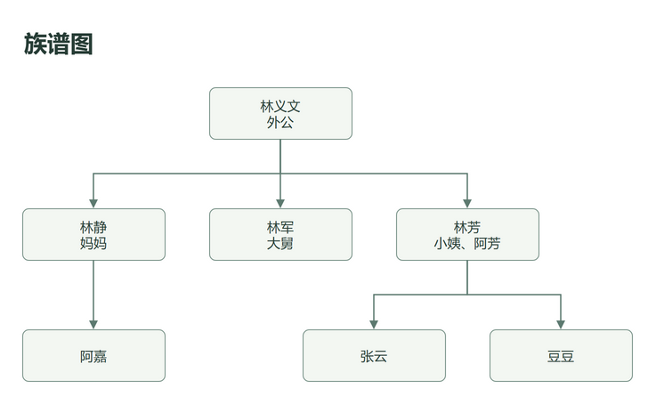

# 口述家谱

对着手机说几句家里人的关系，AI 整理成一份**可以下次接着写的家谱**，还可以画成可编辑的族谱图。整理完以后，也能按已有的人名查「过年见面该怎么喊」。

## 把这句话发给 AI

> 请读取 https://github.com/fuxing0910-hue/oral-family-tree/blob/main/SKILL.md，按里面的规则帮我口述建族谱，核对后保存成可续写的 Excel，再画一份可继续编辑的 `.drawio` 族谱图。

手机可以用键盘听写。只发链接的方式需要当前 AI 能读网页、处理 Excel 文件。支持导入自定义 Skill 的工作模式也可以 [下载 Skill ZIP](https://github.com/fuxing0910-hue/oral-family-tree/releases/latest/download/oral-family-tree.zip)。豆包工作手机端在新任务里调用电脑导入的个人 Skill，尚未实机验证。

## 从一句话开始

> 我叫小宇。我外婆陈兰有三个孩子，老大是大舅李强，老二是我妈李敏，老三是小姨李梅，家里叫她阿梅。

AI 先列出它理解的关系。你确认后，下载《我家族谱.xlsx》。名字或生年想不起来时，可以先空着。新的对话里把最新文件发给 AI，再说一句就能继续。

> 接着这份家谱写。我妈其实排老大，李强排第二。阿梅还有个孩子，小名豆豆。

打开已有家谱，也可以问「小宇该怎么叫阿梅？」AI 应答「小姨」，并显示关系路径。 [两轮试用示例](examples/two-sessions.md) · [Excel 空白模板](assets/jia-pu-template.xlsx)

## 下次还能改图

只想看看图可以直接打开 PNG。要改的话，用 draw.io 打开 `.drawio` 文件，就能双击人物卡片改文字、拖动排版、调整连线和添加备注。保存后可以打开同一个文件继续改。 [示例预览图](examples/family-tree.png) · [虚构家庭的可编辑源图](examples/family-tree.drawio) · [draw.io 打开文件说明](https://www.drawio.com/docs/manual/open-diagram-file/)



要边补录家人边更新图，把最新版 Excel 和你已排过版的 `.drawio` 一起发给 AI，说「接着写，保留旧图的排版」。只影响展示的调整保存在图里。要把改过的姓名或关系用于以后续写、查称呼时，也请让 AI 更新 Excel。

也可以在本地用 Python 3.9 或更新版本导出。首次导出使用第一条，带旧图续写使用第二条。

```sh
python scripts/export_drawio.py "我家族谱.xlsx" --output "我家族谱图.drawio"
python scripts/export_drawio.py "我家族谱.xlsx" --previous "旧族谱图.drawio" --output "更新后族谱图.drawio"
```

## 链接读不到时

把下面这段话直接复制给 AI。续写时同时附上最新版家谱。

> 帮我把中文口述整理成可续写的家谱。按我讲的内容建立人物和亲属关系，保留小名，模糊的地方问我一句，未知信息留空。先用小图或短句让我核对，确认后生成 Excel，分「人物」「关系」两张表，用编号关联。续写前读已有 Excel，保留原编号，更新我明确更正的内容。另生成可编辑的 `.drawio` 族谱图，每个人和每条关系都是独立图形。如有旧图，请保留原来的位置和手工注释。查称呼时按已确认的关系链推导，并告诉我经过谁。

这个项目只发布 Skill、空白模板和虚构例子。家谱文件由你自己保存。项目无需自建服务器或提供 API Key，用量遵循所用 AI 客户端的规则。
